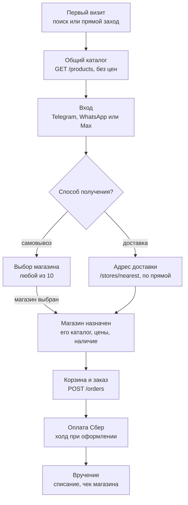

# Хозяин Камчатки — требования к API X.Label для сайта

Версия от 31.10.2026. Живая версия документа — в Claude Docs (проект «Хозяин Камчатки»).

## Контекст

Новый сайт krasikra.ru работает как третий клиент X.Label, рядом с приложениями iOS и Android: каталог, цены, наличие, заказы, оплата и бонусный баланс берутся только из X.Label через Mobile API 1.30. Каталог на сайте больше не ведётся, текущий OpenCart выводится из работы.

Бизнес-правила, на которые опирается этот документ:

- **Основа — XLabel Mobile API 1.30**, тот же клиентский API, что у приложений. Сайт работает с ним через свой сервер; токены в браузер не попадают.
- **Каталог, цены и наличие от одного магазина.** При доставке это ближайший к адресу магазин по прямой (`/stores/nearest`), при самовывозе — магазин, который покупатель выбрал сам из 10. Расстояние считается без учёта Енисея: при 10 магазинах и 5 мостах это приемлемо.
- **Цены показываются после входа и выбора адреса или магазина**, как в приложении. До этого сайт показывает каталог без цен, чтобы страницы индексировались поисковиками.
- **Вход через Telegram, WhatsApp или Max**, без SMS. Гостевых заказов нет: курьеру Яндекс Go нужен подтверждённый телефон.
- **Оплата только онлайн через Сбер по двухстадийной схеме:** холд при оформлении, списание при вручении. Оператор меняет вес весового товара в админке X.Label, итог не превышает холда.
- **Доставку выполняет Яндекс Go** через интеграцию X.Label; интервалы доставки и выдачи, часы работы магазинов настраиваются в админке X.Label.
- **Фискальный чек пробивает касса магазина.** Сайт чеков не формирует.
- **Бонусы и купоны в онлайн-заказах не используются**, как и в приложении сейчас.
- **SEO-данные, дополнительные фото и атрибуты товаров** хранятся в CMS сайта и привязаны к ID товара X.Label. Основное фото, название, цены и наличие всегда берутся из X.Label; синхронизация не затирает поля CMS.

## Что нужно для старта разработки

X.Label готов подготовить все пункты; без первых шести разработка не начнётся, остальные нужны к тестам оплаты и доставки.

- [ ] **Проект-копия в боевой системе X.Label** (отдельного стенда нет): адрес API, реальный каталог, магазины, способы доставки и оплаты; оплата только через тестовый контур Сбера.
- [ ] **Токен приложения** `X-APP-TOKEN` **для сайта** — отдельный от мобильных приложений, для проекта-копии и для боевого проекта.
- [ ] **Публичный ключ проекта для** `hash_code` и схема шифрования. Исходная строка — UUID браузера. На время разработки в проекте-копии подойдёт ключ приложений, отдельный ключ сайта нужен к боевому запуску.
- [ ] **Тестовые боты Telegram, WhatsApp и Max**, подключённые к проекту-копии, и 2–3 тестовых аккаунта покупателей.
- [ ] **Доступ в админку проекта-копии** (или роль оператора), чтобы менять статусы тестовых заказов, вес и смотреть настройки интервалов.
- [ ] **Актуальная спецификация** `openapi.yaml` и контакт разработчика X.Label для вопросов (чат в Telegram или другой канал).
- [ ] **Тестовый контур Сбера**, подключённый к проекту-копии: двухстадийная оплата и тестовые карты.
- [ ] **Настроенные способы доставки в проекте-копии** с реальными тарифами, минимальной суммой и интервалами. Курьера Яндекс Go вызывает оператор, тестовый режим Яндекс Go для сайта не нужен.
- [ ] **Проверка двухстадийной оплаты в копии:** у способа оплаты Сбера `GET /payment_methods` отдаёт `use_two_stage: true`, иначе деньги спишутся сразу.
- [ ] **Лимиты запросов API**, если они есть.

## Задачи для разработчика X.Label

Новых методов API не нужно: все задачи — доработка существующих методов, два поля в настройках проекта и одна миграция. Задачи 1–3 блокируют запуск, порядок выполнения: 1 → 3 → 2; задача 4 — к боевому запуску. Статус на 29.10.2026: все четыре задачи выполнены и выложены (PR №93). У проекта появился отдельный токен сайта (`webAppToken`), ключ сайта — RSA-2048, OAEP, SHA-256, MGF1 SHA-256; адреса возврата хранятся в настройках платёжной системы (`webReturnUrl`, `webFailUrl`); использованный `id_token` даёт 401 «Истек срок действия токена». С настоящим тестовым контуром Сбера не проверено.

### Задача 1. Платформа `web`

**Цель.** Сайт krasikra.ru работает с Mobile API 1.30 как третий клиент наравне с iOS и Android.

1.  `GET /settings`, `GET /versions`: принимать `platform=web` наравне с `android` и `ios` (сейчас `{"error":"Wrong platform"}` в `SettingsController`, `VersionsController`). Для `web` отдавать те же настройки, что для Android; push-токен не требовать.
2.  `POST /orders/{id}/payments/init`: принимать `platform=web`.
3.  `GET /versions` с авторизацией и `platform=web` записывает вход в `AppLogin` с платформой `web`.
4.  Добавить в заказ поле `platform` (миграция) и необязательный параметр `platform` в тело `POST /orders`. Старые клиенты его не передают — поле пустое. Нужно, чтобы отличать заказы сайта в статистике и админке.

**Готово, когда:** при `platform=web` `/settings` и `/versions` отвечают без ошибки, в `AppLogin` и в заказах видна платформа `web`, поведение для `android` и `ios` не изменилось.

### Задача 2. Адреса возврата и вёрстка страницы оплаты Сбера

**Цель.** После оплаты покупатель возвращается на сайт, а на компьютере видит десктопную страницу оплаты.

1.  В настройки проекта (или платёжной системы) добавить поля «URL возврата для сайта: успех» и «…: ошибка» с подстановкой `{order_id}`, например `https://krasikra.ru/order/{order_id}/success` и `…/fail`.
2.  В `OrderController::createPaymentAction` при `platform=web`: передавать в `registerPreAuth.do` / `register.do` `returnUrl` и `failUrl` из этих полей вместо `sberbank://success` и `sberbank://fail`; принимать необязательный параметр `page_view` (`desktop` \| `mobile`) и передавать его в Сбер как `pageView`. Без параметра — текущее поведение (`MOBILE`).
3.  Если `platform=web`, а поля возврата не заполнены, отвечать 400 с понятным текстом.
4.  Для `android` и `ios` всё как сейчас.

**Готово, когда:** в проекте-копии `payments/init` с `platform=web` и `page_view=desktop` возвращает `formUrl`, страница Сбера открывается в десктопной вёрстке, после оплаты тестовой картой браузер приходит на `…/order/{id}/success`.

### Задача 3. Отдельный ключ `hash_code` для сайта

**Цель.** Сайт формирует `hash_code` своим ключом; ключ приложений не раскрывается и не меняется.

1.  Сгенерировать пару RSA-2048 только для сайта; приватный ключ — в Symfony secrets или файле вне web-root с правами 600, не в репозитории.
2.  `CryptoUtils`: несколько ключей. Ключ выбирается по `X-APP-TOKEN`: для токена сайта — ключ сайта с OAEP (SHA-256), для приложений — текущий ключ без изменений.
3.  Расшифрованная строка — UUID v4 браузера (36 символов), идентификатор устройства, как сейчас.
4.  Передать команде сайта публичный ключ в PEM и параметры OAEP (хеш, MGF1).

Альтернатива, если проще: HMAC — `hash_code = UUID + "." + base64(HMAC-SHA256(UUID, секрет сайта))`, секрет привязан к токену сайта.

**Готово, когда:** `/token/*/start` и `/token/{provider}` с `hash_code` ключа сайта проходят, с тем же значением и токеном приложения — отклоняются; входы приложений работают как прежде. **До готовности** в проекте-копии сайт временно использует публичный ключ приложений (PKCS#1 v1.5): он и так есть в каждом установленном приложении.

### Задача 4. Одноразовый `id_token` входа (безопасность, к боевому запуску)

**Проблема.** `id_token` из `/token/{provider}/start` не гасится после успешного входа и содержится в ссылке на мессенджер. Если ссылку перехватили, после подтверждения покупателем сессию может получить тот, у кого есть ссылка.

**Что сделать.** После первой успешной выдачи токенов в `/token/{provider}` помечать `id_token` использованным; повторный вызов — 401 «Токен уже использован». Со своей стороны сайт хранит `id_token` только на сервере и привязывает опрос к браузеру, который начал вход.

### Прочие задачи

| Задача                         | Что нужно                                                                                                                                             | Когда    |
|--------------------------------|-------------------------------------------------------------------------------------------------------------------------------------------------------|----------|
| IP покупателя                  | Добавить IP сервера сайта в `TRUSTED_PROXIES`. Не требуется: лимитов по IP в X.Label нет, а у сайта в Yandex Serverless Containers нет постоянного IP | Не нужно |
| SberPay Web                    | `sberpay.backurl` в `jsonParams` и идентификатор для виджета; веб-вариант SberPay у Сбера                                                             | Этап 2   |
| Трекинг Яндекс Go              | В `GET /orders/{id}`: статус курьера, ссылка на трекинг, время прибытия                                                                               | Этап 2   |
| Ответ 202 «ждём подтверждения» | Вместо 401 на неподтверждённый вход; сейчас сайт различает по тексту                                                                                  | Этап 2   |

## Ответы X.Label

Получены 25.10.2026, составлены по исходному коду. Тестовая среда — новый проект-копия «Хозяина Камчатки» в боевой системе X.Label с тестовым контуром Сбера; отдельного стенда нет.

| Тема                         | Ответ                                                                                                                                                            | Что делает сайт                                                                                                          |
|------------------------------|------------------------------------------------------------------------------------------------------------------------------------------------------------------|--------------------------------------------------------------------------------------------------------------------------|
| `refresh_token`              | Бессрочный; при каждом `/token/refresh` старый удаляется, выдаётся новый                                                                                         | Обновления одного покупателя строго по очереди                                                                           |
| `access_token`               | Живёт 1 год                                                                                                                                                      | Хранится только на сервере сайта                                                                                         |
| Опрос входа через мессенджер | Ограничений нет. Не подтверждён: `401 «Номер телефона не подтвержден»`; истёк: `401 «Истек срок действия токена»`                                                | Опрос 2 с → 5 с; по тексту «истёк» сразу предлагает начать заново                                                        |
| Повторный `/start`           | Старые `id_token` не аннулируются                                                                                                                                | Опрашивает только последний токен                                                                                        |
| Подтверждение оплаты         | `POST /orders/{id}/payments` с `payment_id` = `orderId` Сбера — верно. Callback Сбера в API нет                                                                  | Фоновая проверка неоплаченных заказов (см. «Оплата и доставка»)                                                          |
| Отмена заказа покупателем    | Метода нет, только из админки или кассы                                                                                                                          | Показывает «позвоните для отмены»                                                                                        |
| Статусы заказа               | `created`, `new`, `accepted`, `canceled`, `assembly`, `assembled`, `shipping`, `received`                                                                        | Тексты для покупателя задаёт сайт                                                                                        |
| Статусы оплаты               | `not_payed`, `approved` (холд), `deposited` (списано), `refunded`                                                                                                | То же                                                                                                                    |
| Весовой товар                | Отдельного признака нет: `measure_name`, `multiple_of`, дробное `quantity`                                                                                       | Правило ниже, ждёт подтверждения                                                                                         |
| Режимы доставки              | `price_mode`: `free`, `fixed`, `by_request`; `min_order_mode`: `none`, `fixed`, `by_request`. `valid_until` только для `by_request`, срок задаёт служба доставки | Итог для адреса из `/shipment_methods/{id}/calc`; при `by_request` пересчитывает, если `valid_until` истёк до оформления |
| Геокодинг                    | Каскад Google → DaData → Яндекс                                                                                                                                  | Использует `GET /geocode`                                                                                                |
| Енисей                       | Ближайший по прямой — допустимо                                                                                                                                  | —                                                                                                                        |

**Правило для весового товара (предложение сайта).** `measure_name = «кг»` — весовой товар: покупатель выбирает вес с шагом `multiple_of`, цена показывается за килограмм и за выбранный вес, рядом пометка «итоговая сумма может немного уменьшиться после взвешивания».

## Открытые вопросы

- [ ] **Режим шлюза Сбера** у проекта (`sberEcommerceMode` или `securepayments`) — нужен к этапу 2, для SberPay Web.
- [ ] **Повтор** `/token/{provider}` **в приложениях.** Не повторяют ли приложения запрос автоматически при сетевой ошибке: с одноразовым `id_token` второй запрос даст «Истек срок действия токена».
- [x] Сроки по задачам 1–4 — выполнены 29.10.2026.
- [x] Статистика: «Тест Камчатка» — физически отдельный проект, его входы и заказы в боевую статистику не попадают.
- [x] Лимит пользователей на устройство у «Камчатки» не используется, блокировка подозрительных устройств отключена.
- [x] Неоплаченные заказы никто не отменяет, они остаются в списке заказов со статусом `not_payed`. Сайт проверяет оплату в фоне до 30 минут; неоплаченный заказ в личном кабинете показывается с кнопкой «Оплатить», пока X.Label допускает `payments/init`.
- [x] Округление суммы позиции — математическое до копеек (5 и больше — вверх); подтвердим тестами.
- [x] Фото товаров сайту можно и нужно кешировать у себя (CDN, ресайз, WebP).
- [x] ID товаров при перевыгрузке из кассы сохраняются — CMS привязывается к ID X.Label, задача про артикул не нужна.
- [x] Остатки: «Камчатка» каждое утро обновляет остатки, товара без остатка нет в выдаче (`allow_to_sell`). Сайт подхватывает обновление через `/versions`; товар, распроданный в течение дня, решает оператор при сборке.
- [x] Двухстадийная оплата включена (управляет банк); в копии проверим `use_two_stage: true` в `GET /payment_methods`.
- [x] Поля цены: цена магазина в `price`, акционная уже в `price`, прежняя в `old_price`.
- [x] `-1.00` в `calc` — «расчёт недоступен, повторить»; отказ в доставке — поле `error`.
- [x] `hash_code` сайта: RSA-2048, OAEP, SHA-256, MGF1 SHA-256, шифруется UUID v4 браузера, base64.
- [x] `access_token` — 1 год, `expires_in` входа — 3600 с.

## Карта методов Mobile API 1.30

Все сценарии сайта для запуска покрываются существующими методами; нужны только доработки из таблицы выше. Таблица — для сверки: так сайт планирует использовать API.

| Сценарий сайта                      | Методы                                                                                                                                                                                                                                                                                                                                                                                              |
|-------------------------------------|-----------------------------------------------------------------------------------------------------------------------------------------------------------------------------------------------------------------------------------------------------------------------------------------------------------------------------------------------------------------------------------------------------|
| Настройки и слежение за изменениями | `GET /settings`, `GET /versions` (опрос раз в несколько минут вместо вебхуков)                                                                                                                                                                                                                                                                                                                      |
| Магазины и выбор самовывоза         | `GET /stores`, `GET /stores/{id}`                                                                                                                                                                                                                                                                                                                                                                   |
| Адрес и ближайший магазин           | `GET /streets/search`, `GET /geocode`, `POST /people/addresses/new`, `GET /stores/nearest`                                                                                                                                                                                                                                                                                                          |
| Каталог и цены магазина             | `GET /products?store=` (группы и товары магазина; цена магазина — в `price` товара, при акции прежняя в `old_price`; без `store` цен нет и `allow_to_sell = false`; остатков нет, только `allow_to_sell`), `GET /product_mods`                                                                                                                                                                      |
| Вход                                | `POST /token/{telegram,whatsapp,max}/start` → `POST /token/{provider}`, `POST /token/refresh`                                                                                                                                                                                                                                                                                                       |
| Профиль, бонусный баланс, QR карты  | `GET/POST /people`, `GET /people/accounts`, `GET /people/qr`                                                                                                                                                                                                                                                                                                                                        |
| Адреса и карты покупателя           | `/people/addresses`, `/people/payment_tools`                                                                                                                                                                                                                                                                                                                                                        |
| Подарки и промокоды                 | `GET /coupons`, `POST /coupons/assign`, `POST /coupons/{id}/activate`                                                                                                                                                                                                                                                                                                                               |
| Доставка и самовывоз                | `GET /shipment_methods` (тариф: `price_mode`, `price`, `free_order_amount`, `min_order_mode`, `min_order_amount`), `GET /shipment_methods/{id}/calc` (для конкретного адреса с координатами; `-1.00` — расчёт сейчас недоступен, повторить через несколько секунд; отказ в доставке — поле `error` со статусом 200), `GET /shipment_time_windows`. Стоимость доставки входит в сумму заказа и холда |
| Оплата                              | `GET /payment_methods?store=`                                                                                                                                                                                                                                                                                                                                                                       |
| Заказ                               | `POST /orders`, `GET /orders`, `GET /orders/{id}`, `POST /orders/{id}` (правка адреса, времени или состава покупателем до оплаты, в статусе `created` или `new`)                                                                                                                                                                                                                                    |
| Оплата Сбер                         | `POST /orders/{id}/payments/init` → страница Сбера → `POST /orders/{id}/payments`                                                                                                                                                                                                                                                                                                                   |
| Акции, баннеры, новости             | `GET /adverts`, `GET /banners`, `GET /news`                                                                                                                                                                                                                                                                                                                                                         |

Также пригодится `POST /people/delete` (с v1.29) для удаления аккаунта. Не используются: вход по паролю и SMS, SMM, опросы, push. Отмены заказа покупателем в API нет. Вес весового товара оператор меняет в админке X.Label, через API это недоступно.

## Выбор магазина: доставка или самовывоз

После выбора способа получения всё, что видит покупатель, считается от одного магазина: при доставке ближайшего к адресу, при самовывозе выбранного самим покупателем. От него зависят ассортимент, цены, наличие, доставка. До входа и указания адреса сайт показывает общий каталог без цен, чтобы страницы товаров индексировались поисковиками.

- **Смена адреса или магазина самовывоза меняет магазин.** Сервер сайта пересчитывает корзину по ценам нового магазина из `/products?store=`, недоступные позиции помечаются, новые цены покупатель видит до оплаты.
- **SEO.** Страницы категорий и товаров строятся по общему каталогу с SEO-данными из CMS сайта; цены магазина показываются после входа и указания адреса. Товар без наличия в назначенном магазине остаётся на странице с пометкой «нет в вашем магазине».
- **Выбор запоминается.** store_uuid и адрес хранятся в cookie и в профиле покупателя, чтобы при следующем визите каталог открывался сразу.

## Оплата и доставка

Каждый заказ полностью оплачивается онлайн по двухстадийной схеме, как в приложении: при оформлении сумма холдируется на карте покупателя, а списывается в момент вручения. Оплаты при получении нет. Холд также покрывает весовые товары, которые собираются с отклонением от заказанного веса; в X.Label это видно по полям `orig_quantity` и `quantity` и статусам оплаты `approved` и `deposited`.

1.  Сервер сайта считает суммы по ценам магазина из `GET /products` и стоимости из `/shipment_methods/{id}/calc`, затем вызывает `POST /orders`.
2.  Сайт вызывает `POST /orders/{id}/payments/init` с `platform=web`; X.Label регистрирует холд в Сбере (`registerPreAuth.do` — двухстадийная оплата включена у банка и в способе оплаты X.Label) и возвращает `formUrl` и `orderId`. Сайт сохраняет `orderId`: он нужен для подтверждения и фоновой проверки оплаты.
3.  Покупатель платит на странице Сбера и возвращается на `returnUrl` сайта. Сайт вызывает `POST /orders/{id}/payments`, X.Label сверяет статус со Сбером, сайт показывает итог по `GET /orders/{id}`. Параметрам в адресе возврата сайт не доверяет. Callback Сбера в X.Label нет, поэтому если покупатель закрыл вкладку до возврата, сервер сайта сам раз в несколько минут вызывает `POST /orders/{id}/payments` для своих неоплаченных заказов: иначе деньги захолдированы, а заказ в X.Label числится неоплаченным.
4.  Магазин собирает заказ; оператор указывает в админке X.Label фактический вес весового товара не больше заказанного; холд не пересоздаётся, итог заказа уменьшается.
5.  Заявка Яндекс Go создаётся ещё при расчёте доставки (`calc`) и привязывается к заказу. Статус «Заказ готов» (`assembled`) только уведомляет покупателя; курьера оператор вызывает отдельным действием «подтвердить доставку». Статусы курьера обновляются раз в час. Сайт с Яндекс Go напрямую не работает.
6.  При переводе заказа в «Вручён» (`received`) X.Label списывает фактическую сумму заказа (не больше холда), касса магазина пробивает чек.
7.  При отмене заказа оператором холд снимается; при нехватке товара списывается меньшая сумма, остаток холда освобождает банк. Автоотмены неоплаченных заказов в X.Label нет — процесс нужно согласовать (см. открытые вопросы).

На втором этапе к обычной странице оплаты добавляется кнопка [SberPay Web](https://developers.sber.ru/docs/ru/sberpay-sdk/web/product-description): на компьютере — QR-код для СберБанк Онлайн, на телефоне — переход в приложение банка, повторные покупки до 10 000 ₽ без повторного подтверждения. Виджет работает с двухстадийной оплатой; доработка X.Label описана в таблице задач.

## Технические требования

- **Сервер сайта между браузером и X.Label.** Токен приложения, токены покупателей и `id_token` входа хранятся на сервере; CORS на стороне X.Label не нужен. В `X-Forwarded-For` передаётся только IP покупателя (X.Label учитывает его после настройки `TRUSTED_PROXIES`).
- **Две cookie.** Идентификатор браузера для `hash_code` (создаётся при первом визите, живёт до 2 лет, в аккаунт не пускает) и cookie сессии после входа. Обе недоступны скриптам страницы. При выходе удаляется только сессия.
- **Сессия.** `access_token` живёт 1 год, `refresh_token` бессрочный и при каждом `/token/refresh` заменяется новым. Сервер сайта обновляет токен только по ответу 401 «Access token has expired.», а не по таймеру; обновления одного покупателя идут строго по очереди, новая пара сохраняется сразу (потеря ответа = потеря сессии). Общий опрос `/versions` идёт без токена покупателя, чтобы не записывать лишние входы.
- **Опрос входа через мессенджер.** Первую минуту раз в 2 секунды, дальше раз в 5; не дольше `expires_in` (3600 с); внеочередная проверка при возврате во вкладку. 401 «Номер телефона не подтвержден» — ждать; «Истек срок действия токена» или «Вы не авторизованы» — остановить и предложить начать заново. Опрос привязан к сессии браузера, который начал вход; лимит на сервере сайта — не чаще одного запроса в 2 секунды на попытку.
- **Синхронизация каталога.** По изменению даты в `/versions` сайт забирает `/products` и обновляет в CMS только поля X.Label. Новый товар создаётся с пометкой «нужен контент», исчезнувший снимается с публикации, slug после создания не меняется.
- **Ошибки.** Сайт проверяет поле `error` в ответах со статусом 200 (`POST /orders`, `POST /people/addresses/new`) и показывает текст покупателю.

**Расчёт цен.** X.Label сверяет цену каждой позиции, сумму позиции, `subtotal` и итог со своими до копейки; любое расхождение — заказ не создаётся. Поэтому сервер сайта:

- берёт цену в том же порядке, что X.Label: фиксированная цена товара → цена выбранного магазина → акционная вместо обычной;
- не передаёт купоны: в онлайн-заказах они не используются;
- перед `POST /orders` перечитывает цены магазина из `/products`; если цена изменилась или товар не продаётся в магазине, показывает покупателю «было → стало» и просит подтвердить;
- ошибки `Price of "…" must be …` и «not allowed for sale» перехватывает и обрабатывает так же, покупателю их не показывает.

**Расчёт доставки (режим** `by_request`**, Яндекс Go).** Цену считает Яндекс через заявку, которую X.Label создаёт или обновляет при вызове `calc`; платы за неиспользованные заявки нет. Сервер сайта:

- показывает стоимость доставки уже в корзине, как только известен адрес;
- при `price = -1.00` показывает «рассчитываем доставку» и повторяет `calc` через несколько секунд;
- не хранит цену доставки: перед `POST /orders` заново вызывает `calc`, если прошёл `valid_until`, и при изменении цены обновляет сумму у покупателя;
- при `subtotal` не меньше `free_order_amount` передаёт `shipment_price` = 0 и показывает «до бесплатной доставки осталось … ₽»;
- ошибки `Not found delivery claims` и `Shipment price (…) must be …` обрабатывает повторным `calc`, покупателю их не показывает.
